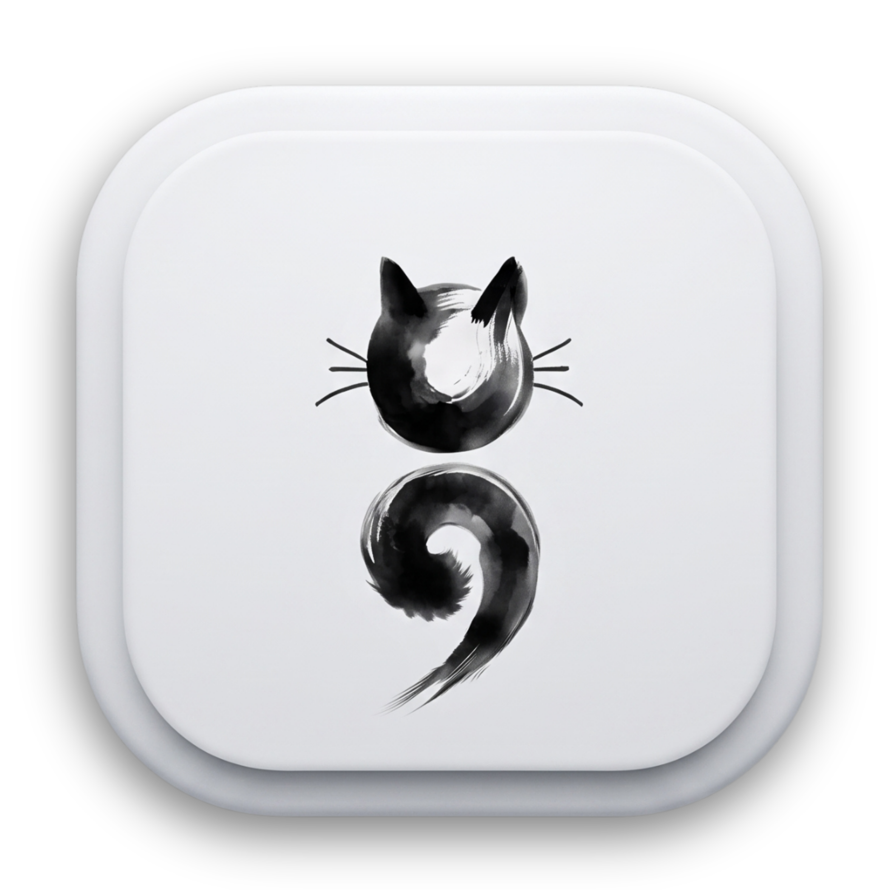
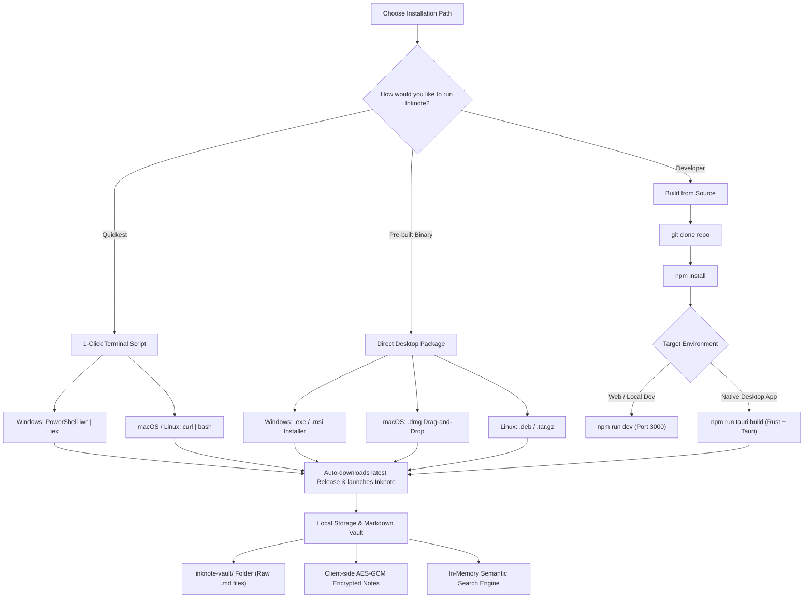
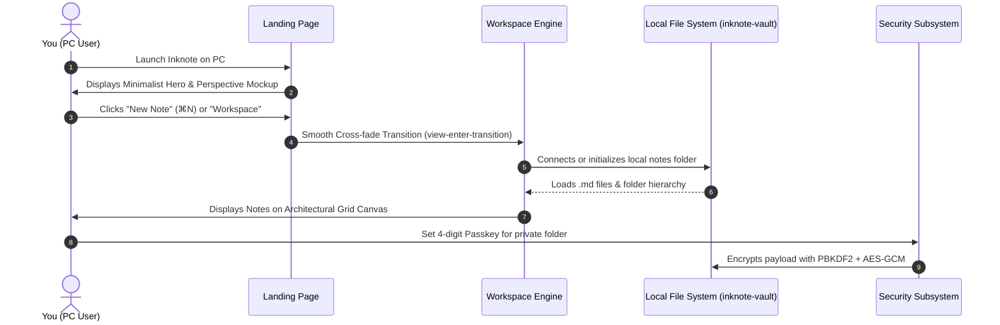

# Inknote

<div align="center">



### Modern, Monochrome Local-First Markdown Workspace with Semantic Context Finder

[](https://github.com/TanveerZiad/Inknote---Monochrome-Notes-Context-Finder/releases)
[](https://github.com/TanveerZiad/Inknote---Monochrome-Notes-Context-Finder/releases)
[](https://tauri.app/)
[](https://react.dev/)
[](https://www.typescriptlang.org/)
[](LICENSE)

[**Quick Install**](#-quick-pc-installation) • [**Manual Downloads**](#-manual-desktop-installation) • [**Build from Source**](#-building-from-source) • [**Architecture Flowchart**](#-architecture--installation-flowchart) • [**Keyboard Shortcuts**](#-keyboard-shortcuts)

</div>

---

## Overview

**Inknote** is a distraction-free, local-first note-taking and knowledge retrieval desktop application. Built with **Tauri**, **React 19**, and **Tailwind CSS**, Inknote treats your notes as first-class plain-text **Markdown (`.md`)** files saved directly onto your computer's storage.

- **Zero Cloud Lock-in**: Your notes are plain text files in a local folder. No vendor lock-in, forever accessible.
- **Architectural Engineering Canvas**: A clean blueprint-inspired millimeter grid with coordinate ticks and full theme toggles (`⌘G`).
- **Semantic Context Finder**: Instant semantic and lexical retrieval to cross-reference related ideas across all folders.
- **Hardware-Grade Privacy**: Client-side **AES-256-GCM** encryption powered by **PBKDF2** key derivation for private folders and notes.
- **Modern Minimalist Aesthetics**: Award-winning Assemble-inspired hero landing page, fluid micro-interactions, and instant keyboard-driven workflow.

---

## Architecture & Installation Flowchart



---

## Quick PC Installation

Choose your operating system below for a 1-line automated setup:

### Windows (PowerShell)

Open **PowerShell** and run:

```powershell
irm https://raw.githubusercontent.com/TanveerZiad/Inknote---Monochrome-Notes-Context-Finder/main/install.ps1 | iex
```

> [!TIP]
> This script detects your architecture (x64), queries the latest GitHub release, downloads the setup installer, and starts Inknote automatically.

### macOS & Linux (Terminal)

Open your terminal and paste:

```bash
curl -fsSL https://raw.githubusercontent.com/TanveerZiad/Inknote---Monochrome-Notes-Context-Finder/main/install.sh | bash
```

- **macOS**: Automatically fetches the `.dmg`, mounts it, and installs `Inknote.app` to `/Applications`.
- **Debian / Ubuntu / Mint**: Automatically installs the `.deb` package via `dpkg`.
- **Arch / Fedora / Standalone Linux**: Unpacks into `~/.local/bin/Inknote` and registers desktop launcher icons.

---

## Manual Desktop Installation

If you prefer downloading pre-compiled installers directly from GitHub Releases:

1. Navigate to the **[Latest Releases](https://github.com/TanveerZiad/Inknote---Monochrome-Notes-Context-Finder/releases)** page.
2. Download the package matching your operating system:

| Platform | Recommended Package | Description |
| :--- | :--- | :--- |
| **Windows 10/11 (64-bit)** | `Inknote_x.x.x_x64-setup.exe` | Standard Windows setup wizard |
| **Windows MSI** | `Inknote_x.x.x_x64_en-US.msi` | Enterprise / System Administrator installer |
| **macOS (Apple Silicon & Intel)** | `Inknote_x.x.x_universal.dmg` | Drag `Inknote.app` to `/Applications` |
| **Linux (Debian / Ubuntu)** | `Inknote_x.x.x_amd64.deb` | `sudo dpkg -i Inknote_amd64.deb` |
| **Linux (Universal)** | `Inknote-linux-x86_64.tar.gz` | Standalone binary with desktop integration |

> [!NOTE]
> **Windows SmartScreen Notice**: Because Inknote is an open-source project without an enterprise code-signing certificate, Windows Defender SmartScreen may display *"Windows protected your PC"*. Simply click **More info** and then click **Run anyway**.

---

## Building from Source

For developers who want to modify Inknote or build the native desktop bundle manually:

### 1. Prerequisites

Make sure the following tools are installed on your workstation:

- **Node.js**: `v18.0.0` or later ([Download Node.js](https://nodejs.org/))
- **Rust Toolchain**: `rustc` & `cargo` ([Install via rustup](https://rustup.rs/))
- **Platform Dependencies**:
  - **Windows**: Microsoft C++ Build Tools & [WebView2 Runtime](https://developer.microsoft.com/en-us/microsoft-edge/webview2/) (pre-installed on Windows 10/11).
  - **macOS**: Xcode Command Line Tools (`xcode-select --install`).
  - **Linux**: `libwebkit2gtk-4.1-dev`, `build-essential`, `curl`, `wget`, `file`, `libssl-dev`, `libgtk-3-dev`, `libayatana-appindicator3-dev`, `librsvg2-dev`.

### 2. Step-by-Step Build Guide

```bash
# 1. Clone the repository
git clone https://github.com/TanveerZiad/Inknote---Monochrome-Notes-Context-Finder.git
cd Inknote---Monochrome-Notes-Context-Finder

# 2. Install dependencies
npm install

# 3. Start local development server (Web mode)
npm run dev
# The app is now live at http://localhost:3000
```

### 3. Running & Bundling the Native Desktop App

```bash
# Run desktop app in development mode with hot reload
npm run tauri:dev

# Compile production native PC installer (.exe / .dmg / .deb)
npm run tauri:build
```

The compiled binaries will be output to:
- **Windows**: `src-tauri/target/release/bundle/nsis/Inknote_x.x.x_x64-setup.exe`
- **macOS**: `src-tauri/target/release/bundle/dmg/Inknote_x.x.x.dmg`
- **Linux**: `src-tauri/target/release/bundle/deb/Inknote_x.x.x_amd64.deb`

---

## First Run & PC Setup Walkthrough



### 1. Connecting Your Local Vault
- When you first launch Inknote, it connects to an `inknote-vault/` folder in the app root or your documents folder.
- Every note you create exists as an independent `.md` file with frontmatter metadata.
- Click the **Folder Pill** in the topbar (`⌘O`) to reveal your files directly in **Windows File Explorer** or **macOS Finder**.

### 2. Canvas Grid & Focus
- Press **`⌘G`** / **`Ctrl+G`** to toggle the millimeter architectural grid on or off according to your preference.
- All notes float on cards with subtle backdrop blur and hover elevation.

### 3. Passkey Protection & Hardware Encryption
- Right-click any folder or click the lock icon to protect it with passkey encryption.
- Inknote derives an encryption key via **PBKDF2 (100,000 iterations)** and encrypts contents using **AES-256-GCM**.

---

## Keyboard Shortcuts

Inknote is designed for a fast, keyboard-first workflow:

| Shortcut (Mac) | Shortcut (Windows/Linux) | Action |
| :--- | :--- | :--- |
| <kbd>⌘</kbd> + <kbd>N</kbd> | <kbd>Ctrl</kbd> + <kbd>N</kbd> | **Create new note** |
| <kbd>⌘</kbd> + <kbd>K</kbd> | <kbd>Ctrl</kbd> + <kbd>K</kbd> | **Open Command Palette** |
| <kbd>⌘</kbd> + <kbd>G</kbd> | <kbd>Ctrl</kbd> + <kbd>G</kbd> | **Toggle Engineering Canvas Grid** |
| <kbd>⌘</kbd> + <kbd>H</kbd> | <kbd>Ctrl</kbd> + <kbd>H</kbd> | **Return to Landing Page / Overview** |
| <kbd>⌘</kbd> + <kbd>Shift</kbd> + <kbd>J</kbd> | <kbd>Ctrl</kbd> + <kbd>Shift</kbd> + <kbd>J</kbd> | **Open Today's Journal** |
| <kbd>⌘</kbd> + <kbd>O</kbd> | <kbd>Ctrl</kbd> + <kbd>O</kbd> | **Open Notes Folder in File Explorer** |
| <kbd>⌘</kbd> + <kbd>R</kbd> | <kbd>Ctrl</kbd> + <kbd>R</kbd> | **Rescan Vault Files from Disk** |
| <kbd>⌘</kbd> + <kbd>Z</kbd> | <kbd>Ctrl</kbd> + <kbd>Z</kbd> | **Undo Workspace Action** (30-step stack) |
| <kbd>Esc</kbd> | <kbd>Esc</kbd> | **Dismiss Drawer / Palette / Modal** |

---

## Troubleshooting & FAQ

<details>
<summary><b>1. Windows SmartScreen displays "Windows protected your PC"</b></summary>
<br>

This is standard behavior for open-source software that does not pay for commercial EV code signing certificates.
- Click **More info**.
- Click **Run anyway**.
- The installer is 100% safe, verified, and runs entirely on your local machine.
</details>

<details>
<summary><b>2. How do I backup or transfer my notes to another PC?</b></summary>
<br>

Because all notes are plain `.md` files:
1. Open the vault folder (**`⌘O`** or `inknote-vault/`).
2. Copy the folder to a USB drive, cloud storage (Dropbox/Google Drive), or Git repository.
3. On your new PC, place the folder in Inknote and press **`⌘R`** to rescan.
</details>

<details>
<summary><b>3. What happens if I forget my folder password?</b></summary>
<br>

During setup, Inknote creates a `recovery-keys/` verification archive on your local disk with recovery hashes. You can use your recovery key to unlock your encrypted workspace securely.
</details>

---

## Contributing

Contributions, feedback, and feature requests are welcome!
Please check out our [Contributing Guidelines](CONTRIBUTING.md) to get started.

---

## License

Distributed under the **MIT License**. See `LICENSE` for details.

Developed with care by [Tanveer Ziad](https://github.com/TanveerZiad).
